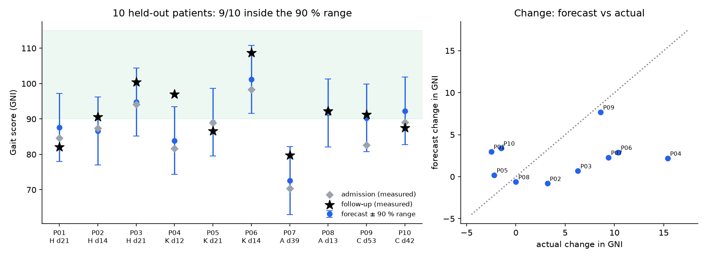

# GaitTwin — AI-Driven Predictive Simulation of Gait & Post-Treatment Functional Outcomes

 

 

> **One gait test at admission → a simulated gait waveform for any day of rehabilitation, with calibrated uncertainty and a clinically scaled outcome score.**

A patient arrives for inpatient rehabilitation after a hip, knee, ankle or calcaneus injury and walks over force plates once. **GaitTwin** forecasts:
- the full 10-channel ground-reaction-force pattern (both limbs: 3 force components + 2 centre-of-pressure traces, 101 points of stance) at any follow-up day,
- a conformal **90 % prediction band** around it,
- a **GRF Normalcy Index (GNI)**: 100 = healthy average, −10 = one SD further from normal,
- the probability of a **clinically meaningful improvement**,

and it lets you run *what-if* simulations over rehabilitation time and footwear.

**For clinicians:** upload your own patient's force-plate export (CSV/Excel, any units) and get a forecast, an on-track check against a follow-up test and a one-page PDF report. See [Clinical app](#clinical-app-upload-your-own-patient).

## Data

**GaitRec** (Horsak et al., 2020, *Scientific Data* 7:143, CC BY 4.0): force-plate gait recorded at the AUVA rehabilitation centre (Austria).

| | |
|---|---|
| Sessions | 8,971 (2,084 patients + 211 healthy controls) |
| Patients with ≥ 2 visits in one admission | **1,854** → 5,627 before/after-treatment pairs |
| Test set (GaitRec's own patient-level TEST flag) | 551 patients, 592 admissions, median 22 days to last visit |
| Training augmentation | every earlier → later visit within an admission (8,287 pairs) |

The data are **not** redistributed here; `scripts/download_data.py` fetches them from figshare.

## Method (summary; full design in [`docs/methodology.md`](docs/methodology.md))

1. **Representation.** Trials are averaged per session and the limbs are re-ordered to *affected / contralateral*.
2. **Outcome layer, GNI.** A PCA manifold of healthy and patient gait (47 PCs, 98 % variance). The log distance from the healthy mean is z-scored like the Gait Deviation Index.
3. **Forecasters.** All predict the *change* from admission, conditioned on age, BMI, sex, diagnosis group, bilateral involvement, insole, footwear and elapsed days.
   - Persistence (no change), and mean change by diagnosis × time
   - PCA + Ridge, and PCA + gradient boosting
   - **GaitTwin CNN:** 1-D CNN encoder + FiLM conditioning + heteroscedastic β-NLL head, as a 5-member deep ensemble
   - **GaitTwin stack:** a convex blend of the CNN ensemble and Ridge, with the weight (0.35) chosen on validation patients
4. **Calibration.**
   - Split-conformal scaling of the ensemble σ for waveform bands.
   - **Severity-aware recalibration of predicted ΔGNI**, fitted on validation patients: ΔGNI = a + b·Δpred + c·(GNI_baseline − 85). Scoring an averaged waveform makes it look more "normal" than real gait (a Jensen gap), so uncalibrated forecasts over-predict improvement by 2–3 points. A doctor's-eye check also showed that a single offset under-predicted recovery in the most impaired patients and over-predicted it in near-normal ones. The baseline-severity term fixes most of that.
5. **Reliability.** A split-half (odd vs even trials) analysis gives the measurement-noise ceiling.

## Results: held-out patients, last follow-up visit (n = 592)

| Model | Waveform RMSE ↓ | GNI MAE ↓ | r (ΔGNI) ↑ | Responder AUROC ↑ |
|---|---|---|---|---|
| Persistence (no change) | 0.0315 | 5.36 | — | 0.500 |
| Mean change (class × time) | 0.0281 | 4.98 | 0.348 | 0.661 |
| PCA + Ridge | 0.0255 | 4.96 | 0.347 | 0.661 |
| PCA + Gradient Boosting | 0.0260 | 5.00 | 0.356 | 0.668 |
| GaitTwin CNN (ensemble) | 0.0266 | 5.05 | 0.339 | 0.647 |
| **GaitTwin stack** | **0.0254** | **4.94** | **0.366** | **0.669** |

- **Waveform error vs persistence:** the stack cuts it by 19 % (35 % in MSE). It is significantly better than persistence, mean change, gradient boosting and the CNN alone (subject-level paired bootstrap; 95 % CIs exclude 0). Its edge over PCA + Ridge alone is **not** significant.
- **Uncertainty is calibrated:**
  - 90 % waveform bands cover **89.7 %** of test points.
  - 90 % GNI intervals (± 9.6 points) cover **86.7 %** of last-visit outcomes.
- **By diagnosis (r for ΔGNI):** calcaneus 0.43, ankle 0.40, knee 0.38, hip 0.26.
- **Calibrated across severity** (stack, mean ΔGNI, true → predicted): baseline GNI < 70: 3.2 → 4.5 (n = 29); 70–80: 4.8 → 3.6 (n = 81); 80–90: 2.3 → 2.3 (n = 224); ≥ 90: −0.2 → 0.0 (n = 258). Overall bias −0.004 points.
- **Responder probability** (P[ΔGNI ≥ 5]): Brier 0.190 vs 0.203 for the base rate. It is informative but modest, so the app shows it as Low / Moderate / Higher rather than as a precise percentage.
- **Measurement is reliable:** GNI split-half ICC = **0.96**, SEM = 1.9 points, MDC95 = 5.3 points. That justifies the responder threshold (ΔGNI ≥ 5).

### What this means

Measurement noise accounts for only ~15 % of the variance in recovery. Baseline gait plus demographics explain ~13 %. **The remaining ~72 % is real patient-to-patient variation that force plates at admission cannot see.** Likely sources are therapy dose, pain, weight-bearing orders, fracture fixation and psychosocial factors. This is the central research finding. It motivates multimodal models (clinical notes, imaging, wearables, treatment logs) as the next step.

**Occlusion analysis:** forecasts depend most on the affected limb's **medio-lateral centre-of-pressure at initial contact and push-off**. This is a testable biomechanical hypothesis: foot roll-over strategy may be an early marker of recovery potential.

## Simulation

## End-to-end check: 10 held-out patients through the app

The validation script takes 10 real GaitRec TEST patients (3 hip, 3 knee, 2 ankle, 2 calcaneus; spread across baseline severity; never seen in training). It exports each admission test as a raw lab file (Newtons, mm, 3 noisy trials, 300 samples) and runs it through the app's own upload code. It then compares the forecast with the follow-up test that was actually measured.

| | GaitTwin | "No change" guess |
|---|---|---|
| Gait-score error (mean, GNI points) | **5.2** | 6.0 |
| Waveform error (RMSE, × BW) | **0.023** | 0.030 |
| Actual score inside the 90 % range | **9 / 10** | — |

- **The upload step is accurate.** Converting from the raw Newton/mm files changed the gait score by at most 0.14 points.
- **Weakness:** the size of each patient's change is predicted poorly. Correlation is 0.30, and the forecast flagged only 1 of the 5 real improvers, though that one was correct. Patient P04 improved by +15 points, far beyond the forecast. This matches the main finding above: most recovery variation is not visible in an admission force-plate test.

## Clinical app: upload your own patient

The Streamlit clinical app ([live here](https://gaittwin-gait-recovery.streamlit.app/); code in the private full repository) is a two-mode tool designed around what a rehabilitation doctor needs at the bedside:

| Step | What the clinician does | What the app does |
|---|---|---|
| 1. Patient | Enters age, sex, height, mass, injury group, affected side, test footwear, insole, re-admission | Builds the model's covariates (BMI from height and mass) |
| 2. Upload | Drops the force-plate export (CSV / TXT / Excel) | Recognises common column names (`F_V`/`Fz`, `COP_AP`/`COPy`, `_left`/`_R`, …). Averages trials, resamples to 101 points, converts **Newtons → × body weight** and **mm/cm → m**, and fixes sign conventions. It reports every conversion and rejects implausible data (vertical peak outside 0.5–2 × BW). |
| 3. Forecast | Picks the follow-up day (1–60) and planned footwear | Shows the gait score now and at that day with a 90 % range, the chance of a meaningful improvement (≥ 5 points, MDC95 = 5.3) and the day near-normal gait is expected |
| 4. Follow-up (optional) | Uploads a second test and the days between tests | **On-track check:** BELOW expected / lower part of range / ON TRACK / BETTER than expected |

The app also gives:
- **Safety flags.** An out-of-distribution warning when the gait pattern is unlike the training data (Mahalanobis distance, 99th percentile). It also flags a low chance of improvement, persisting loading asymmetry (LSI < 90 %) and a patient already in the healthy range.
- **Views.** Gait curves against a healthy ± 1 SD band, the recovery trajectory with a footwear what-if, and a gait-parameter table (loading, push-off, braking, propulsion and symmetry vs healthy).
- **A one-page PDF report** (summary, tables, flags, data-processing notes, figure) and a CSV of the forecast curves.
- **A template and three example files**: body-weight CSV, Newtons/mm CSV with 3 trials, and Excel plus a follow-up test, taken from held-out GaitRec patients.

Footwear what-ifs are **associations** learned from observational data, not causal treatment effects. This is a research prototype and **not a medical device**.

## Source code

This public repository is a **showcase**: write-up, figures, interactive pages, research design and all reported metrics ([`results/metrics.json`](results/metrics.json)). The full pipeline lives in a private repository: data download, training, the GaitTwin model, trained weights, reliability analysis, tests, Colab notebook and the Streamlit clinical app (upload your own patient, PDF report). **Source access and a live demo are available on request** via GitHub ([Engr-HusainNaqvi](https://github.com/Engr-HusainNaqvi)).

## Limitations

- **Single centre, observational data.** Counterfactual footwear and time sweeps are associations, not causal effects.
- **Ground-reaction forces only.** No joint kinematics, EMG or patient-reported outcomes.
- **No external test set.** Validation is on held-out patients from the same centre. External validation is needed, e.g. on the Van Criekinge 2023 stroke dataset or other clinical cohorts.
- **Research and education only. Not a medical device.**

## Citation & license

**Copyright © 2026 Husain Naqvi. All Rights Reserved.** See [LICENSE](LICENSE). No reuse without written permission. Reviewers (admissions committees, prospective supervisors, employers) may view the work for evaluation. Source access is available on request via GitHub (Engr-HusainNaqvi).

Data: Horsak B. et al. *GaitRec, a large-scale ground reaction force dataset of healthy and impaired gait.* Sci Data 7, 143 (2020). [doi:10.1038/s41597-020-0481-z](https://doi.org/10.1038/s41597-020-0481-z)
