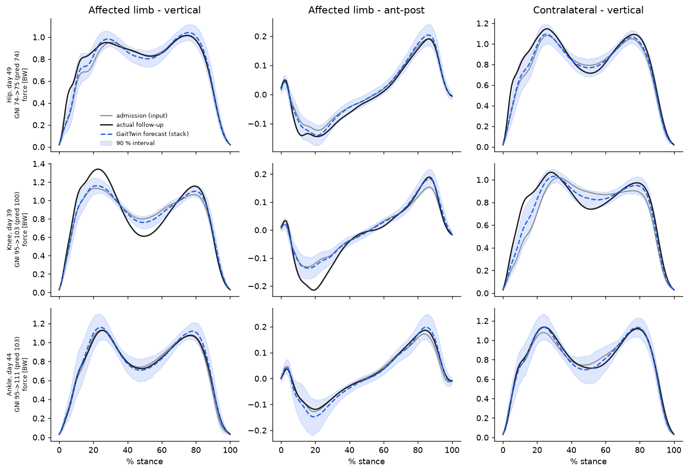
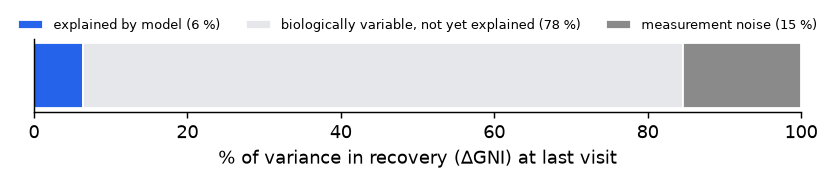
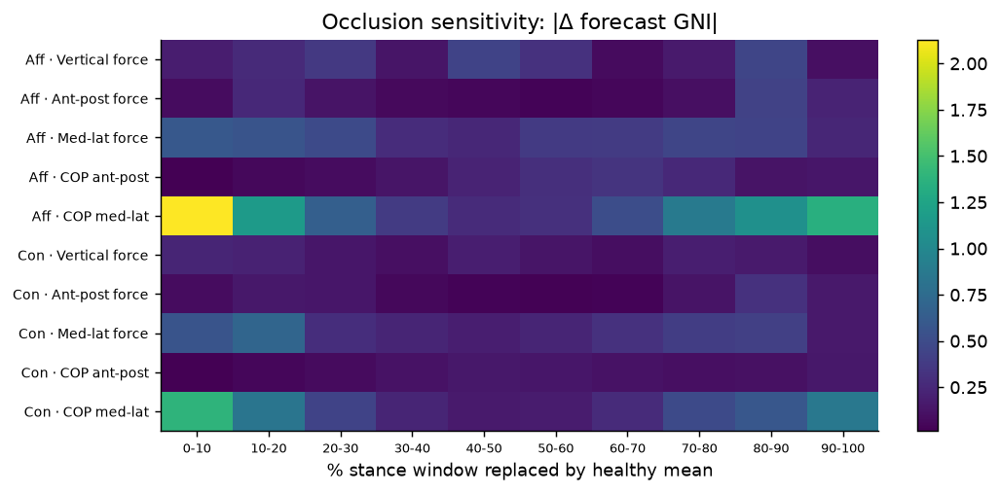
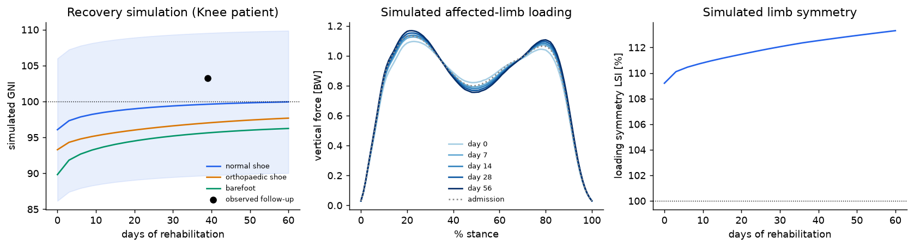

# GaitTwin — AI-Driven Predictive Simulation of Gait & Post-Treatment Functional Outcomes

 

> **One gait test at admission → a simulated gait waveform for any day of rehabilitation, with calibrated uncertainty and a clinically scaled outcome score.**

A patient arrives for inpatient rehabilitation after a hip, knee, ankle or calcaneus injury and walks over force plates once. **GaitTwin** forecasts:
- the full 10-channel ground-reaction-force pattern (both limbs: 3 force components + 2 centre-of-pressure traces, 101 points of stance) at any follow-up day,
- a conformal **90 % prediction band** around it,
- a **GRF Normalcy Index (GNI)**: 100 = healthy average, −10 = one SD further from normal,
- the probability of a **clinically meaningful improvement**,

and it lets you run *what-if* simulations over rehabilitation time and footwear.

## Data

**GaitRec** (Horsak et al., 2020, *Scientific Data* 7:143, CC BY 4.0): force-plate gait recorded at the AUVA rehabilitation centre (Austria).

| | |
|---|---|
| Sessions | 8,971 (2,084 patients + 211 healthy controls) |
| Patients with ≥ 2 visits in one admission | **1,854** → 5,627 before/after-treatment pairs |
| Test set (GaitRec's own patient-level TEST flag) | 551 patients, 592 admissions, median 22 days to last visit |
| Training augmentation | every earlier → later visit within an admission (8,287 pairs) |

The data are **not** redistributed here.

## Method (summary; full design in [`docs/methodology.md`](docs/methodology.md))

1. **Representation.** Trials are averaged per session and the limbs are re-ordered to *affected / contralateral*.
2. **Outcome layer, GNI.** A PCA manifold of healthy and patient gait (47 PCs, 98 % variance). The log distance from the healthy mean is z-scored like the Gait Deviation Index.
3. **Forecasters.** All predict the *change* from admission, conditioned on age, BMI, sex, diagnosis group, bilateral involvement, insole, footwear and elapsed days.
   - Persistence (no change), and mean change by diagnosis × time
   - PCA + Ridge, and PCA + gradient boosting
   - **GaitTwin CNN:** 1-D CNN encoder + FiLM conditioning + heteroscedastic β-NLL head, as a 5-member deep ensemble
   - **GaitTwin stack:** a convex blend of the CNN ensemble and Ridge, with the weight (0.35) chosen on validation patients
4. **Calibration.**
   - Split-conformal scaling of the ensemble σ for waveform bands.
   - Validation-fitted linear recalibration of predicted ΔGNI. Scoring an averaged waveform makes it look more "normal" than real gait (a Jensen gap). Without the fix, forecasts over-predict improvement by 2–3 GNI points.
5. **Reliability.** A split-half (odd vs even trials) analysis gives the measurement-noise ceiling.

## Results: held-out patients, last follow-up visit (n = 592)

| Model | Waveform RMSE ↓ | GNI MAE ↓ | r (ΔGNI) ↑ | Responder AUROC ↑ |
|---|---|---|---|---|
| Persistence (no change) | 0.0315 | 5.36 | — | 0.500 |
| Mean change (class × time) | 0.0281 | 5.06 | 0.223 | 0.616 |
| PCA + Ridge | 0.0255 | 5.05 | 0.241 | 0.619 |
| PCA + Gradient Boosting | 0.0259 | 5.12 | 0.239 | 0.613 |
| GaitTwin CNN (ensemble) | 0.0266 | 5.15 | 0.257 | 0.612 |
| **GaitTwin stack** | **0.0254** | **5.04** | **0.269** | **0.631** |

- **Waveform error vs persistence:** the stack cuts it by 19 % (35 % in MSE). It is significantly better than persistence, mean change, gradient boosting and the CNN alone (subject-level paired bootstrap; 95 % CIs exclude 0). Its edge over PCA + Ridge alone is **not** significant.
- **Uncertainty is calibrated:**
  - 90 % waveform bands cover **89.7 %** of test points.
  - 90 % GNI intervals (± 9.9 points) cover **87.5 %** of last-visit outcomes.
- **By diagnosis (r for ΔGNI):** calcaneus 0.37, ankle 0.30, knee 0.28, hip 0.17.
- **Measurement is reliable:** GNI split-half ICC = **0.96**, SEM = 1.9 points, MDC95 = 5.3 points. That justifies the responder threshold (ΔGNI ≥ 5).

### What this means

Measurement noise accounts for only ~15 % of the variance in recovery. Baseline gait plus demographics explain ~6 %. **The remaining ~78 % is real patient-to-patient variation that force plates at admission cannot see.** Likely sources are therapy dose, pain, weight-bearing orders, fracture fixation and psychosocial factors. This is the central research finding. It motivates multimodal models (clinical notes, imaging, wearables, treatment logs) as the next step.

**Occlusion analysis:** forecasts depend most on the affected limb's **medio-lateral centre-of-pressure at initial contact and push-off**. This is a testable biomechanical hypothesis: foot roll-over strategy may be an early marker of recovery potential.

## Simulation

The Streamlit app (in the private full repository) turns the model into an interactive "gait digital twin":
- pick a held-out patient,
- move the rehabilitation-day slider,
- switch footwear,
- compare the simulation with what actually happened.

The footwear switch shows an **association** learned from observational data, not a causal treatment effect.

## Source code

This public repository is a **showcase**: write-up, figures, interactive pages, research design and all reported metrics ([`results/metrics.json`](results/metrics.json)). The full pipeline lives in a private repository: data download, training, the GaitTwin model, trained weights, reliability analysis, tests, Colab notebook and the Streamlit simulator. **Source access and a live demo are available on request** via GitHub ([Engr-HusainNaqvi](https://github.com/Engr-HusainNaqvi)).

## Limitations

- **Single centre, observational data.** Counterfactual footwear and time sweeps are associations, not causal effects.
- **Ground-reaction forces only.** No joint kinematics, EMG or patient-reported outcomes.
- **No external test set.** Validation is on held-out patients from the same centre. External validation is needed, e.g. on the Van Criekinge 2023 stroke dataset or other clinical cohorts.
- **Research and education only. Not a medical device.**

## Citation & license

**Copyright © 2026 Husain Naqvi. All Rights Reserved.** See [LICENSE](LICENSE). No reuse without written permission. Reviewers (admissions committees, prospective supervisors, employers) may view the work for evaluation. Source access is available on request via GitHub (Engr-HusainNaqvi).

Data: Horsak B. et al. *GaitRec, a large-scale ground reaction force dataset of healthy and impaired gait.* Sci Data 7, 143 (2020). [doi:10.1038/s41597-020-0481-z](https://doi.org/10.1038/s41597-020-0481-z)
